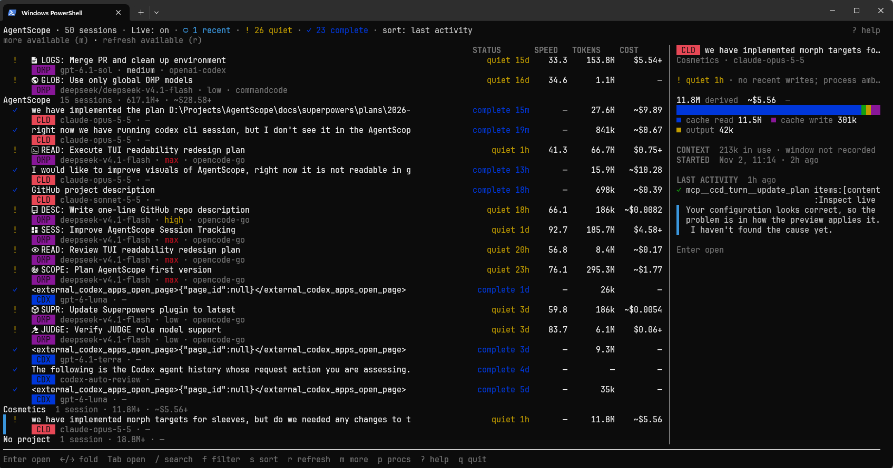
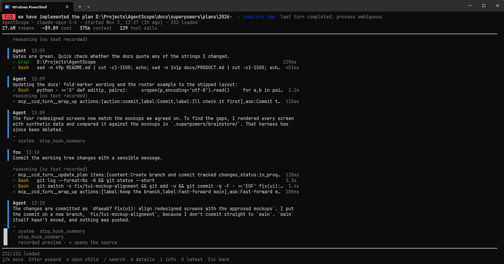
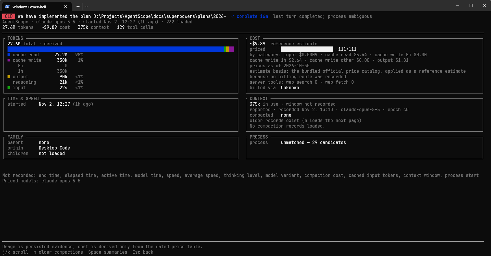

# AgentScope

**One terminal dashboard for all your AI coding agents.** See what they're doing, what they're using, and whether they're actually stuck.

You run Codex in one terminal, Claude Code in another, and OpenCode somewhere else. Each keeps its own logs in its own format. Which session burned all those tokens? Is that agent still working, or did it quietly die twenty minutes ago? What did it actually do?

AgentScope puts every session on one machine into a single keyboard-driven TUI. It reads the logs your agents already write. It never launches, stops or messages them, and it never changes their data.

**Works with:** Codex CLI · Claude Code (CLI and Desktop) · OpenCode · OMP (oh-my-pi) · Hermes · Pi



<table>
  <tr>
    <td width="50%"></td>
    <td width="50%"></td>
  </tr>
  <tr>
    <td align="center"><em>Transcript: messages, tool calls and timings</em></td>
    <td align="center"><em>Details: tokens, cost estimate, context and family</em></td>
  </tr>
</table>

## Why AgentScope

- **See everything in one place.** One roster across all harnesses, with search, filter and sort. Subagents, forks and continuations are nested under their parent session.
- **Read what really happened.** Browse the full transcript: messages, reasoning summaries, tool calls and results, errors. Huge records load lazily, and the raw source record is always one key away.
- **Trust the numbers.** Token counts follow each provider's own usage rules, so duplicated streaming events and cumulative counters aren't double-counted. Costs are labeled as estimates. Unknown stays `Unknown`, never `$0.00`.
- **Know if an agent is stuck, with proof.** Status comes from evidence (`Active`, `Quiet`, `Possibly stalled`, `Complete`, `Failed`, and more) and always shows its reason. Silence is never presented as a crash.
- **Safe to point at your real sessions.** It's read-only and local, with no telemetry and no network. Terminal escape sequences in untrusted transcripts are neutralized, and common secrets are masked by default.

## Install

Download the archive for your platform from the [latest release](https://github.com/etelyatn/AgentScope/releases/latest). Each archive holds a single `agentscope` binary; put it anywhere on your `PATH`.

| Platform | Archive |
|---|---|
| macOS (Apple Silicon) | `agentscope-aarch64-apple-darwin.tar.gz` |
| Linux (x86_64, glibc 2.35+) | `agentscope-x86_64-unknown-linux-gnu.tar.gz` |
| Windows (x64) | `agentscope-x86_64-pc-windows-msvc.zip` |

**macOS / Linux**

```bash
curl -LO https://github.com/etelyatn/AgentScope/releases/latest/download/agentscope-aarch64-apple-darwin.tar.gz
tar -xzf agentscope-aarch64-apple-darwin.tar.gz agentscope
mkdir -p ~/.local/bin && mv agentscope ~/.local/bin/
```

On Linux, use the `x86_64-unknown-linux-gnu` archive name instead. The binary is not notarized: if macOS blocks a copy downloaded through a browser, run `xattr -d com.apple.quarantine ~/.local/bin/agentscope`.

**Windows (PowerShell)**

```powershell
Invoke-WebRequest https://github.com/etelyatn/AgentScope/releases/latest/download/agentscope-x86_64-pc-windows-msvc.zip -OutFile agentscope.zip
Expand-Archive agentscope.zip -DestinationPath "$env:LOCALAPPDATA\Programs\agentscope"
```

Then add `%LOCALAPPDATA%\Programs\agentscope` to your `PATH`, or run `agentscope.exe` from that folder. SmartScreen may warn about an unsigned binary on first run.

Each release also publishes `SHA256SUMS.txt` to check the downloads.

**From source** (stable Rust):

```bash
cargo install --git https://github.com/etelyatn/AgentScope --locked
```

## Usage

```bash
agentscope
```

AgentScope finds the default session folders of every supported agent on its own and opens the roster. Run it in an interactive terminal of at least 60×20; from 150 columns a preview of the selected session is shown beside the list.

**Getting around:**

| Key | Action |
|---|---|
| `j` / `k`, arrows | Move |
| `Enter` | Open a session's transcript |
| `→` / `←` | Expand or collapse subagents and forks |
| `/` | Search |
| `f` / `s` | Filter / sort |
| `m` | Load the next 50 sessions |
| `d` / `i` | Event details / session info (in a transcript) |
| `v` | Show the raw source record |
| `Esc` | Back |
| `r` | Refresh |
| `?` | Help: all keys and what each glyph means |
| `q` | Quit |

The roster shows the newest 50 project groups; search and filters cover only what is loaded, so press `m` to widen them. Live sessions update on their own: new events, appended records and rotated files are picked up without restarting.

**Reading the numbers:** `—` means not available, `…` not read yet, `+` a partial total (a lower bound), `~` an estimate. Costs are always API-equivalent estimates from a price catalog built into the binary, not your actual bill.

**Custom locations.** If an agent keeps its sessions somewhere other than the default, point AgentScope at it:

```bash
agentscope --codex-sessions D:/stores/codex/sessions --claude-projects ~/work/.claude/projects
```

The same settings, plus refresh intervals, status thresholds and price overrides, can go in `config.toml` (`%APPDATA%\agentscope\` on Windows, `~/Library/Application Support/agentscope/` on macOS, `~/.config/agentscope/` on Linux). Other useful flags: `--no-processes`, `--no-color`, `--no-mouse`; `agentscope --help` lists them all.

The complete reference (every key, glyph, option, config key, default location and pricing override) is in [docs/USAGE.md](docs/USAGE.md).

## Status

**Pre-release (v0.1).** All six readers, the transcript explorer, usage accounting, process candidates and the TUI are implemented and covered by synthetic-fixture tests that pass on Windows, macOS and Linux. Interactive and real-data validation has so far been done on Windows only.

Things to know before relying on it:

- **Cost is an estimate**, and stays `Unknown` when a model, billing route or token counter cannot be priced.
- **Speed is mostly `Unknown`**: most agents do not record per-request timing.
- **Process matching is conservative**: most sessions show `Unmatched` or only same-provider candidates.
- **Not read:** Claude Desktop chat history, Pi extension subagents, and sessions inside WSL, on other machines or in cloud accounts.
- **OpenCode and Hermes:** SQLite may create its `-shm`/`-wal` sidecar files next to a live database; this is the one exception to the read-only guarantee ([ADR-0002](docs/decisions/0002-opencode-readonly-wal-sidecars.md)).

Full verification details and per-provider limitations: [docs/VERIFICATION.md](docs/VERIFICATION.md).

## Security and privacy

Coding-agent logs may include private prompts, repository contents, paths, credentials, and untrusted terminal output. AgentScope neutralizes control sequences, masks common credential patterns by default (best effort — it cannot identify every secret), and bounds record and page sizes. In the transcript, `x` toggles masking for the selected record's source view; nothing is ever transmitted. Do not paste real transcripts into issues.

AgentScope does not start, stop, signal, or approve coding agents, and never modifies their session stores, configuration, permissions, or credentials. It has no network listeners, telemetry, or uploads.

## Development

See [Contributing](CONTRIBUTING.md), [Product requirements](docs/PRODUCT.md) and [Architecture](docs/ARCHITECTURE.md). With a stable Rust toolchain:

```bash
cargo run --release
cargo fmt --all -- --check
cargo clippy --all-targets -- -D warnings
cargo test
```

Releases are built by [`.github/workflows/release.yml`](.github/workflows/release.yml) when a `v*` tag matching the `Cargo.toml` version is pushed.

## License

Licensed under the [Apache License, Version 2.0](LICENSE).
